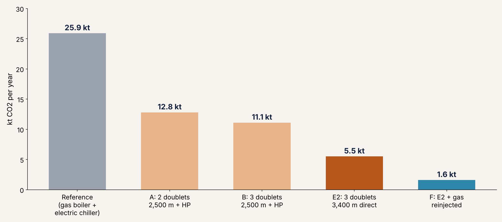

# GeoBalance: geothermal heating and cooling, designed with AI

My contribution to **team GeoBalance** in the **SPE Europe Energy GeoHackathon 2026 (Express Edition)**.

The challenge: supply a district with 30 MW of heating (100 °C) in winter and 10 MW of cooling (20 °C) in summer from one deep geothermal reservoir, using agentic AI and the [GEMINI geothermal digital twin](https://github.com/GEMINI-Digital-Twin/gemini-geothermal-suite-open).

**Result:** 3 geothermal doublets at 3,400 m with direct heating, an electric chiller and a gas engine on the associated methane. All demand is met on all 365 days with no backup boiler, and CO₂ is **79% lower** than a gas-boiler reference (94% with gas reinjection).



## My part

This was a team project with **Tareq Aljamou**, who built the AI agent and the GEMINI integration. The full team code is in [pull request #59](https://github.com/GEMINI-Digital-Twin/gemini-geothermal-suite-open/pull/59) to GEMINI.

I was responsible for:

- **Subsurface analysis:** reservoir temperature from the geothermal gradient, and why going from 2,500 m (87 °C) to 3,400 m (114 °C) removes the need for a heat pump.
- **Hand-calculation tools** (`tools.py`): doublet heat, Darcy doublet pressure and pump power, heat pump, absorption and electric chillers, and gas engine. The agent uses them to cross-check GEMINI, and the 365-day simulation runs on them.
- **Automated tests** (`tests/test_tools.py`): 12 tests that check the tools against the challenge data and hand calculations, and that every broken limit gives a warning.
- **Technical report and presentation** (`docs/`).

## Run it

```bash
pip install pytest
python -m pytest tests        # 12 tests, all pass
python tools.py               # example output of each tool
```

Every function in `tools.py` explains what it calculates, its units and a worked example. Both files score 10/10 in pylint.

## Files

| File | What it is |
|---|---|
| `tools.py` | Hand-calculation tools (Python, standard library only) |
| `tests/test_tools.py` | 12 automated tests |
| `data/` | Daily heating and cooling demand for 2027, from the challenge |
| `docs/GeoBalance_Technical_Report.pdf` | Technical report (5 pages + appendix) |
| `docs/GeoBalance_Presentation.pdf` | Presentation slides |
| `figures/` | Demand profile and CO₂ comparison |

## What I learned

- The pump, not the reservoir, limits each doublet to about 240 m³/h: above that, the pump intake drops below the gas bubble point.
- An AI agent becomes reliable through tools, guard rails and checks in code, not through longer prompts, and its output must still be checked against the tools.
- Tests with known answers are the fastest way to trust (or find bugs in) your own code.
